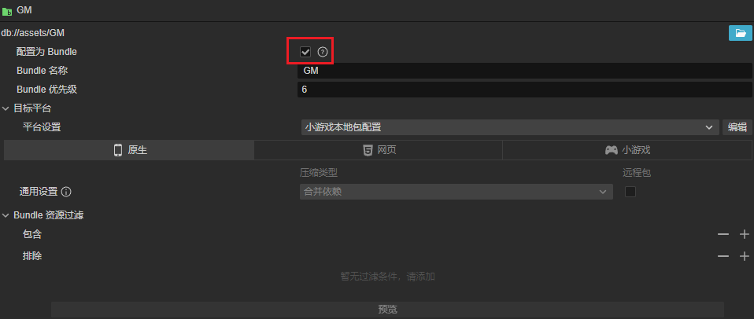
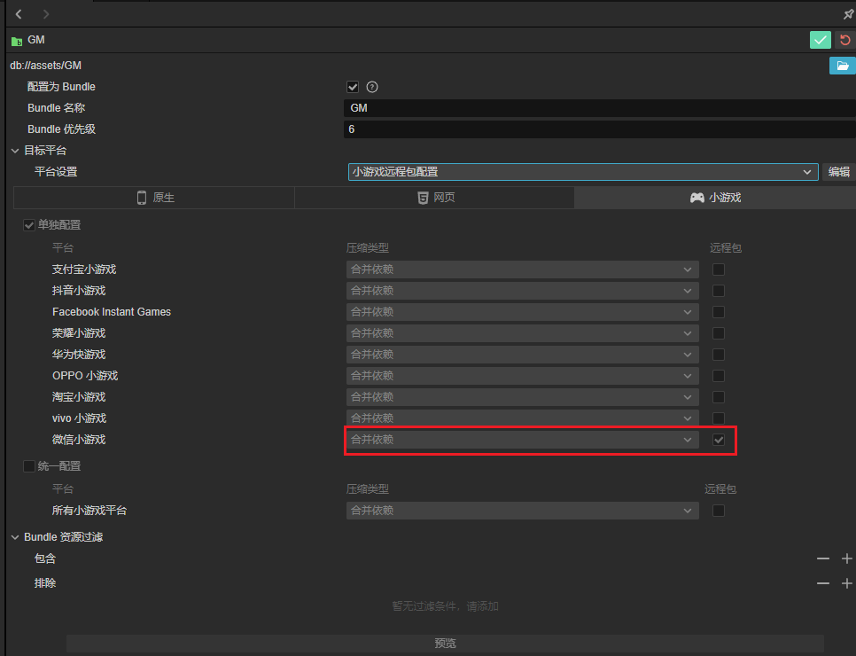
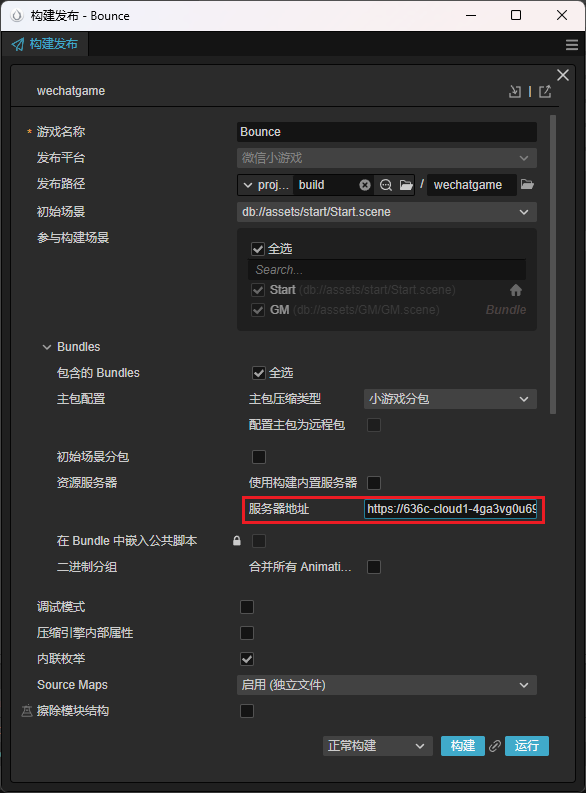
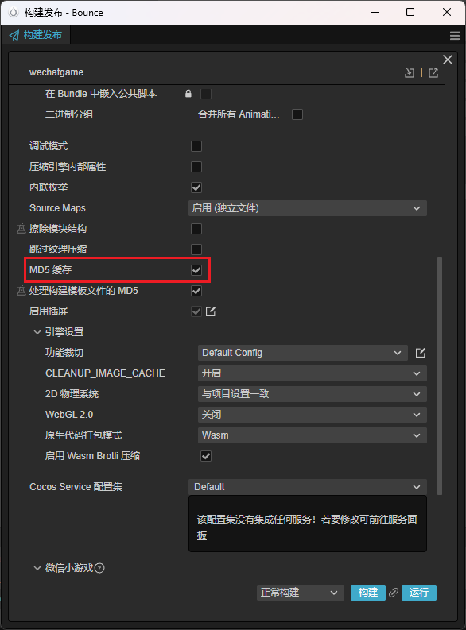
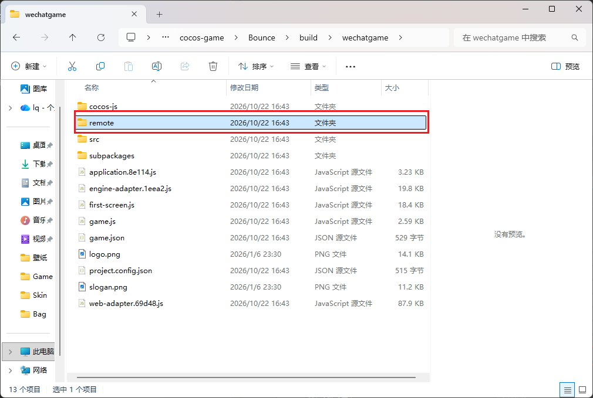

## 前言

小游戏热更新的实现。

## 正文

1. 将分包文件配置为Bundle

2. 平台设置勾选远程包

3. 构建发布面板，配置资源服务器地址

4. 必须勾选md5缓存，然后开始打包

- **为什么？**：MD5缓存会在文件名后面自动拼接一段根据文件内容计算出的 哈希唯一标识。告诉微信客户端“哪些文件变了需要重新下载，哪些文件没变直接用旧缓存”的唯一凭证。 做 CDN 热更新必须依赖它！

5. 打包完成后，会生成如下文件夹：

- 里面包含了配置为远程包的bundle

6. 之后我们需要将这些文件上传到我们的cdn服务器上，